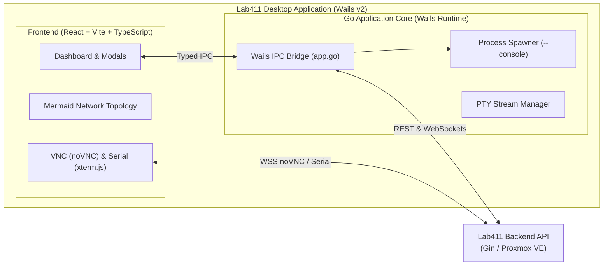

# Lab411 VM Manager — Desktop Client

[](https://wails.io/)
[](https://go.dev/)
[](https://react.dev/)
[](https://www.typescriptlang.org/)
[](https://vitejs.dev/)
[](LICENSE)

A cross-platform desktop application for managing virtual machines and software-defined network topologies on **Proxmox VE**. Built with **Wails v2**, **React**, and **TypeScript**, it provides students and engineers with a visual interface for provisioning VMs, wiring virtual networks, and accessing live graphical and serial consoles.

---

## Key Features

- **Live VM Fleet Management**: Real-time overview of assigned virtual machines, execution states (Running / Stopped), allocated memory, and attached VirtIO interfaces.
- **Interactive Network Topology Map**: Dynamic graph rendered via Mermaid.js depicting VM nodes and their point-to-point NIC links (`net0 <-> net1`) in real time.
- **Software-Defined Networking Controls**:
  - Connect two VMs together on dedicated, isolated VLAN tags with a few clicks.
  - Hot-add new VirtIO network interfaces (`net0` through `net31`).
  - Disconnect or remove interfaces without manual Proxmox configuration.
- **Dual Console Experience**:
  - **Graphical Display**: Native HTML5 VNC client powered by `@novnc/novnc` with auto-scaling, clipboard synchronization, and full-screen support.
  - **Serial Terminal**: Fast text-based console powered by `@xterm/xterm` and `@xterm/addon-fit` streaming directly from Proxmox termproxy over WebSockets.
- **Multi-Window Pop-Out**: Launch consoles into independent OS windows (`--console <id> --name <name> --token <token>`), enabling side-by-side terminal workflows.
- **Template-Based Provisioning**: Rapidly instantiate new sandboxes by selecting from available pre-configured cluster templates.
- **Secure Session Management**: Automatic session validation on startup with token caching in `localStorage`.

---

## Desktop Architecture



---

## Prerequisites

- **Go**: 1.24 or newer
- **Node.js**: 18.x or 20.x+ and **npm**
- **Wails CLI**: v2 (`go install github.com/wailsapp/wails/v2/cmd/wails@latest`)
- **Platform Dependencies**:
  - **Linux**: `libgtk-3-dev`, `libwebkit2gtk-4.1-dev` (or `4.0`), `build-essential`, `pkg-config`
  - **macOS**: Xcode Command Line Tools
  - **Windows**: WebView2 runtime (pre-installed on Windows 10/11)

---

## Development

### 1. Install Frontend Dependencies

```bash
cd frontend
npm install
cd ..
```

### 2. Configure Backend Endpoint (Optional)

By default, the client communicates with `http://localhost:8080`. To point to a remote backend server, set the `BACKEND_URL` environment variable:

```bash
export BACKEND_URL="http://192.168.1.100:8080"
```

### 3. Run Live Development Server

Launch the application with live hot-reloading for both Go and React code:

```bash
wails dev
```

> **Tip**: You can also open `http://localhost:34115` in your browser during `wails dev` to access the frontend directly with browser DevTools.

---

## Building for Production

Compile a redistributable, production-ready binary for your current operating system:

```bash
wails build
```

The compiled executable will be placed in the `build/bin/` directory:
- **Linux**: `build/bin/lab411-vm-manager`
- **macOS**: `build/bin/lab411-vm-manager.app`
- **Windows**: `build/bin/lab411-vm-manager.exe`

### Multi-Window Console Mode

The compiled binary supports a dedicated console launcher mode used internally when popping out a terminal into its own window:

```bash
./build/bin/lab411-vm-manager --console <vmid> --name "<vm_name>" --token "<auth_token>"
```

---

## Project Structure

```text
vm-manager/
├── app.go                  # Go backend logic: HTTP calls to API, PTY, window spawning
├── app_test.go             # Unit tests for Go backend
├── main.go                 # Wails runtime entry point & window configuration
├── wails.json              # Wails project definition & build scripts
├── build/                  # Application icons, plists, and installer scripts
└── frontend/
    ├── src/
    │   ├── App.tsx         # Main application controller & state machine
    │   ├── VMConsole.tsx   # Dual noVNC / xterm.js console component
    │   ├── components/
    │   │   ├── Header.tsx                 # Navigation & user session info
    │   │   ├── Login.tsx                  # User authentication form
    │   │   ├── VMTable.tsx                # VM list with action controls
    │   │   ├── CreateVMCard.tsx           # Template clone dialog
    │   │   ├── NetworkMap.tsx             # Mermaid.js topology renderer
    │   │   ├── NetworkingModal.tsx        # Add/remove NICs & connect VMs
    │   │   └── NetworkTopologyModal.tsx   # Modal wrapper for network graph
    │   └── wailsjs/        # Auto-generated Go-to-TypeScript bindings
    ├── package.json
    └── vite.config.ts
```

---

## License

This project is licensed under the [MIT License](LICENSE).
